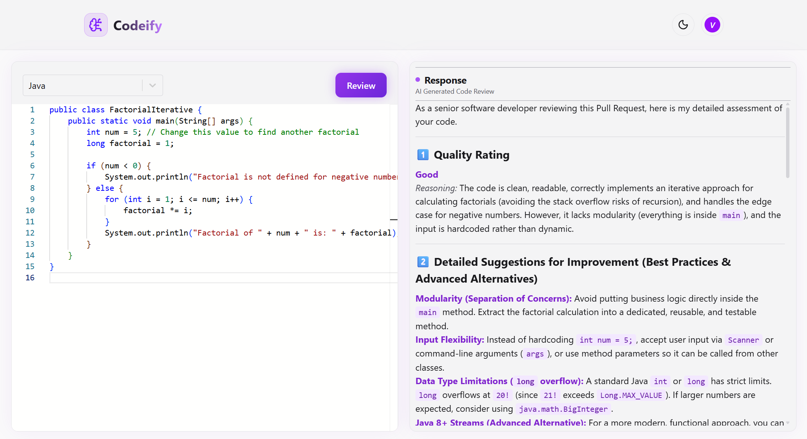
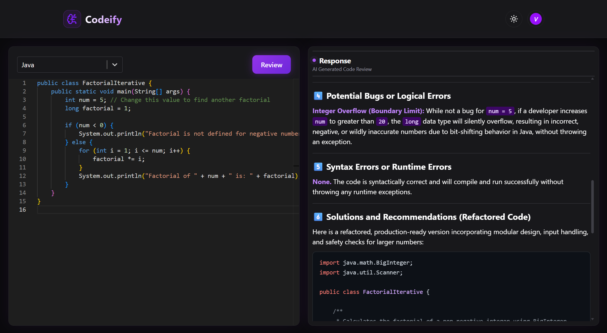
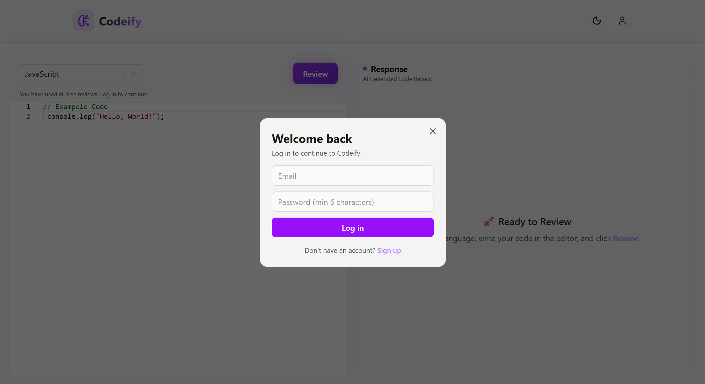
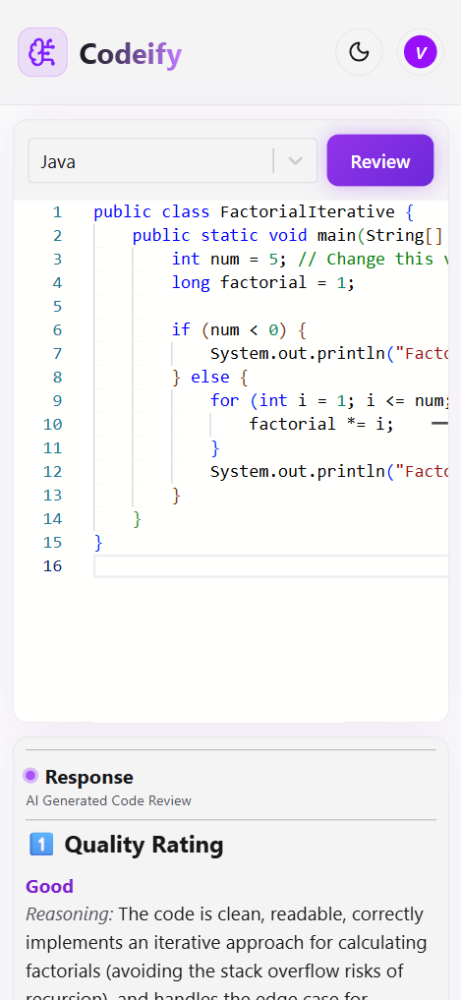

# 🧠 Codeify - AI Powered Code Review System

Codeify is a full-stack web app that reviews your code like a senior developer. Paste code in the editor, pick a language, and get an instant AI review with a quality rating, step-by-step explanation, bug detection, and fix suggestions.

**🔗 Live Demo:** [https://codeify-ai-delta.vercel.app/]

> ⏳ The backend runs on Render's free tier, so the **first login or signup can take 30-60 seconds** while the server wakes up. After that it is fast.

**Demo login (optional):** `demo@codeify.com` / `Demo@123`

---

## 📸 Screenshots

| Light theme | Dark theme |
| --- | --- |
|  |  |

| Login / Signup | Mobile view |
| --- | --- |
|  |  |

---

## ✨ Features

- **AI code review** powered by Google Gemini: quality rating, improvement suggestions, step-by-step explanation, bug and error detection, and fixes
- **Monaco code editor** (the editor used in VS Code) with syntax highlighting for **25 languages**
- **Syntax-highlighted review output** rendered from Markdown, with styled headings, code blocks, and inline code
- **Language mismatch detection:** a red underline and a popup appear when the code does not match the selected language
- **JWT authentication:** signup, login, and persistent sessions with passwords hashed using bcrypt
- **Free trial for visitors:** 3 free reviews without logging in, then a login prompt
- **Light and dark theme toggle:** opens in light mode first, and remembers your choice
- **Friendly popups** for empty editor, free limit reached, and language mismatch (no browser alerts)
- **Fully responsive:** side-by-side panels on desktop, stacked editor and response on mobile

---

## 🛠️ Tech Stack

**Frontend**

| Technology | Purpose |
| --- | --- |
| React 19 + Vite | UI and fast dev build |
| Tailwind CSS v4 | Styling and responsive layout |
| Monaco Editor (`@monaco-editor/react`) | Code editor |
| react-select | Language dropdown |
| react-markdown + rehype-highlight + highlight.js | Rendering and highlighting the AI review |
| Google Gemini API (`@google/genai`) | AI code review |
| lucide-react, react-spinners | Icons and loader |

**Backend**

| Technology | Purpose |
| --- | --- |
| Node.js + Express 5 | REST API |
| MongoDB + Mongoose | Database and user schema |
| JSON Web Tokens (`jsonwebtoken`) | Authentication |
| bcryptjs | Password hashing |
| cors, dotenv | Cross-origin requests and environment variables |

**Deployment:** Vercel (frontend), Render (backend), MongoDB Atlas (database)

---

## 📁 Project Structure

```
Codeify/
├── public/
├── src/
│   ├── api/
│   │   └── auth.js              # fetch helpers for signup, login, /me
│   ├── components/
│   │   ├── AuthModal.jsx        # login / signup popup
│   │   ├── CodeEditor.jsx       # editor + review logic
│   │   ├── EmptyCodeModal.jsx   # "no code to review" popup
│   │   ├── LimitModal.jsx       # free limit reached popup
│   │   ├── MismatchModal.jsx    # language mismatch popup
│   │   └── Navbar.jsx           # logo, theme toggle, user menu
│   ├── context/
│   │   ├── AuthContext.jsx      # logged-in user state
│   │   └── ThemeContext.jsx     # light/dark theme state
│   ├── App.jsx
│   ├── App.css
│   ├── index.css
│   └── main.jsx
├── server/
│   ├── config/db.js             # MongoDB connection
│   ├── middleware/auth.js       # JWT route protection
│   ├── models/User.js           # user schema + bcrypt hashing
│   ├── routes/auth.js           # signup, login, me
│   ├── server.js                # Express app entry point
│   └── package.json
├── index.html
├── package.json
└── vite.config.js
```

---

## 🔐 How Authentication Works

1. **Signup / Login:** the server hashes the password with bcrypt, or compares it with the stored hash.
2. The server returns a **JWT** (valid for 7 days) and the user's basic details.
3. The frontend stores the token in `localStorage` and sends it as `Authorization: Bearer <token>`.
4. On page load, the app calls `GET /api/auth/me` with the token to restore the session.

### API Endpoints

| Method | Endpoint | Description | Auth |
| --- | --- | --- | --- |
| POST | `/api/auth/signup` | Create an account | No |
| POST | `/api/auth/login` | Log in and receive a token | No |
| GET | `/api/auth/me` | Get the logged-in user | Yes (Bearer token) |

---

## 🚀 Run It Locally

### Prerequisites

- [Node.js](https://nodejs.org/) 20 or higher
- A [MongoDB Atlas](https://www.mongodb.com/atlas) account (free) or a local MongoDB
- A [Google Gemini API key](https://aistudio.google.com/apikey)

### 1. Clone the repository

```bash
git clonehttps://github.com/vineet6389kg
cd your-repo-name https://github.com/vineet6389kg/Codeify---ai-powered-code-review-system
``` 

### 2. Set up the backend

```bash
cd server
npm install
```

Create `server/.env`:

```env
PORT=5000
MONGO_URI=your_mongodb_connection_string
JWT_SECRET=your_long_random_string
CLIENT_URL=http://localhost:5173
```

Generate a strong `JWT_SECRET` with:

```bash
node -e "console.log(require('crypto').randomBytes(64).toString('hex'))"
```

Start the server:

```bash
npm run dev
```

You should see `MongoDB connected` and `Server running on port 5000`.

### 3. Set up the frontend

Open a new terminal in the project root:

```bash
npm install
```

Create `.env` in the project root:

```env
VITE_API_URL=http://localhost:5000/api
VITE_GEMINI_API_KEY=your_gemini_api_key
```

Start the app:

```bash
npm run dev
```

Open `http://localhost:5173`.

> Never commit `.env` files. Both are already listed in `.gitignore`.

---

## ☁️ Deployment

**Backend on Render**

- Root Directory: `server`
- Build Command: `npm install`
- Start Command: `npm start`
- Environment variables: `MONGO_URI`, `JWT_SECRET`, `CLIENT_URL` (your Vercel URL, no trailing slash), `NODE_VERSION=22`
- In MongoDB Atlas, allow access under **Network Access** (`0.0.0.0/0`) so Render can connect

**Frontend on Vercel**

- Framework preset: Vite, Build Command: `npm run build`, Output Directory: `dist`
- Environment variables: `VITE_API_URL` (your Render URL + `/api`), `VITE_GEMINI_API_KEY`

---

## ⚠️ Known Limitations

- **Gemini is called from the frontend** to keep this project simple. This means the API key is visible in the browser. I use a separate key restricted to this site's domain. In a production app, I would move the call to a backend route (`POST /api/review`) so the key stays on the server.
- **The 3 free reviews limit is stored in the browser** (`localStorage`), so it is a demo feature and can be reset by clearing site data. A real limit would be enforced on the server.
- **Language mismatch detection is a best guess** based on keyword matching (highlight.js), so it can be wrong for very short snippets or very similar languages.
- **Render's free tier sleeps** after about 15 minutes without traffic, so the first request after a break is slow.

---

## 🔮 Future Improvements

- Move the Gemini call to the backend and add server-side rate limiting
- Save review history for each logged-in user in MongoDB
- "Fix Code" button that returns the corrected code
- Google sign-in
- Copy and download buttons for the review

---

## 📚 What I Learned

- Building a full-stack app end to end: React frontend, Express API, and MongoDB database
- Implementing JWT authentication with password hashing and protected routes
- Managing global state with React Context (auth and theme)
- Integrating a third-party AI API and rendering its Markdown output safely
- Writing responsive layouts with Tailwind CSS and building a light/dark theme using CSS variables
- Deploying a split frontend and backend, and handling CORS and environment variables

---

## 👨‍💻 Author

**Vineet Kumar**
B.Tech Computer Science and Engineering, 3rd Year (5th Semester)
Dr. Ram Manohar Lohia Awadh University

- GitHub: [https://github.com/vineet6389kg]
- LinkedIn: [https://www.linkedin.com/in/vineet-kumar-046373329/]
- Email: vineetkmar9336a@gmail.com

---

⭐ If you found this project useful, consider giving it a star!